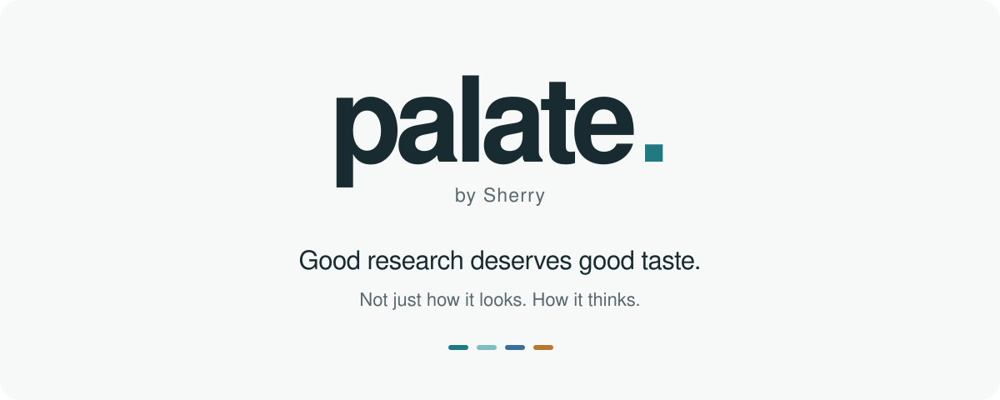

<picture>
  <source media="(prefers-color-scheme: dark) and (max-width: 640px)" srcset="docs/media/palate-dark-mobile.svg">
  <source media="(max-width: 640px)" srcset="docs/media/palate-light-mobile.svg">
  <source media="(prefers-color-scheme: dark)" srcset="docs/media/palate-dark.svg">
  
</picture>

<!-- language-navigation -->
<p align="center">
  <a href="README.md" lang="en">English</a> &nbsp;·&nbsp;
  <a href="README.zh-CN.md" lang="zh-CN">简体中文</a> &nbsp;·&nbsp;
  <a href="README.ja.md" lang="ja">日本語</a> &nbsp;·&nbsp;
  <a href="README.ko.md" lang="ko">한국어</a>
</p>
<!-- /language-navigation -->

<p align="center">
  <a href="#使ってみる">使ってみる</a> &nbsp;·&nbsp;
  <a href="#-sherrys-picks">Sherry's Picks</a> &nbsp;·&nbsp;
  <a href="docs/usage.md">詳しい使い方（英語）</a>
</p>

*A palate for ideas, a palette for slides.*

**palate** は、研究者のプレゼン資料をよりわかりやすく整えるスキルです。複雑な研究内容でも、聞き手が話の流れを追いやすいように、構成からデザインまで見直します。

**今あるプレゼン資料を、そのままアップロードしてください。** 文字が詰まっていても、レイアウトがばらばらでも、まだ作成途中でもかまいません。あらかじめ整えておく必要はありません。

**palate** はまず、誰に向けて、何を、どのくらいの時間で伝える発表なのかを確認します。その内容を踏まえて説明の流れを組み直し、強調すべきポイントを整理しながら、各スライドのレイアウトと情報の優先順位を調整して、研究の根拠、分析、結論が伝わるように整えます。

学会発表、研究室でのミーティング、授業では、必要な説明の深さも見せ方も異なります。そのため、**palate** は決まったテンプレートに当てはめず、発表の目的や場面に合わせて構成とデザインを考えます。その過程で、研究データを勝手に変更したり、結論の意味を変えたりすることはありません。結果の解釈に関わる仮定、適用条件、不確実性も省きません。

完成後は、**編集可能なプレゼン資料**と、変更点や確認した内容、追加で確認が必要な箇所をまとめた短いレポートを受け取れます。

## &nbsp; 使ってみる

### 01 | **palate** をインストールする

利用する環境に合わせて設定します。

| 利用環境 | 設定方法 |
| :--- | :--- |
| Codex | 下記の依頼でスキルをインストールします。 |
| ChatGPT Work（Web） | [専用ガイド](docs/chatgpt-work.md)に従って非公開プラグインを作成します。**実験段階です。ブラウザでのインストールと、資料編集を最初から最後まで通した動作は、どちらも未検証です。** |

Codex を開き、次の依頼を貼り付けます。Codex が実行環境と必要なツールを確認し、インストールを進めます。

```text
https://github.com/sherryyan1/palate-by-sherry から Codex スキル palate をインストールしてください。

Codex が動作する環境を確認し、docs/installation.md に従って、$palate が利用可能になったことを確認してください。すでにインストールされている場合は、置き換える前に確認してください。
```

ChatGPT Work（Web）では、[専用ガイド](docs/chatgpt-work.md)に従い、利用可能な Plugin Creator でこのリポジトリから非公開の **palate** プラグインを作成します。利用できる機能はアカウントやワークスペースによって異なります。`@` の候補に **palate** が表示され、実行に必要なファイル一式を読み取れることを確認するまで、設定は保留とし、未完了の内容を案内します。ローカルの Codex にインストールしたスキルは、自動的には同期されません。

### 02 | プレゼン資料をアップロードする

今あるプレゼン資料を添付します。文字が多くても、レイアウトがそろっていなくても、作成途中でもかまいません。

**Codex：** 次のように依頼します。

```text
$palate でこのプレゼン資料を整えてください。
```

**ChatGPT Work（Web）：** 入力欄で `@` を入力し、候補から **palate** を選んでから依頼します。文字として `@palate` と書くだけでは、プラグインを選択したことにはなりません。

```text
このプレゼン資料を整えてください。
```

### 03 | 発表について **palate** に伝える

依頼を送ると、**palate** が次の4点を確認します。

- **発表の場：** 研究室のミーティング、チュートリアル、外部向けの発表など、どのような場を想定していますか？
- **持ち時間：** 何分の発表を予定していますか？
- **スクリーンの比率：** 会場のスクリーンは 4:3 と 16:9 のどちらに近いですか？ わからない場合は、**palate** が資料の現在の比率を保ちます。
- **説明の詳しさ：** 技術的な内容をどこまで詳しく説明しますか？ **palate** に判断を任せることもできます。

提示された選択肢から選んでも、自由に回答してもかまいません。すでに伝えた内容を、もう一度答える必要はありません。

Codex のインストール先は、Codex が動作する Windows、macOS、Linux の実行環境です。チャットに使う端末と、Codex が実際に動作するコンピュータやリモート環境は、同じとは限りません。iOS／iPadOS 上でのネイティブインストールは、この手順の対象外です。追加の権限や操作、Codex の再起動が必要な場合は、その時点で Codex が案内します。手動で設定する場合は[インストール手順](docs/installation.md)を参照してください。

## &nbsp; 対応言語

この README は **English、简体中文、日本語、한국어** で読めます。ページ上部のリンクから表示言語を切り替えられます。

翻訳を依頼しない限り、**palate** はプレゼン資料の元の言語を保ちます。翻訳する場合も、数値、単位、科学的な意味は変えません。専門用語に複数の訳語があり、選び方によって科学的な意味が変わる場合は、推測で決めずに確認します。

## &nbsp; Sherry's Picks

根拠を **cherry-pick** した発表は、慎重に聞く。**Sherry's Picks** で磨いた発表は、自信をもって語る。

根拠そのものを選り分けるのではなく、その伝え方を工夫します。**palate** は、全体の方向性を定めてから細部を整えるまで、次の4つの考え方を軸にプレゼン資料を見直します。

### &nbsp; 01 | 聞き手と場を見極める

<sub><em>まず、聞き手を知る。</em></sub>

どのような場で、誰が聞くのか。すでに何を知っていて、発表後に何を理解していてほしいのか。デザインは、こうした問いから始まります。

**palate** は、聞き手、目的、発表の場を踏まえて、プレゼン資料全体のスタイルを定めます。学会発表、研究室のミーティング、一般向けの講演では、ふさわしい見せ方も異なります。どの発表にも同じデザインを当てはめることはしません。


### &nbsp; 02 | 話の筋道を通す

<sub><em>先を聞きたくなる流れをつくる。</em></sub>

個々のスライドがよくできていても、それだけでよい発表になるとは限りません。考えがつながり、論理が無理なく展開していくことが大切です。

**palate** はプレゼン資料全体を見渡し、中心となる主張を捉えたうえで構成を見直します。必要に応じてスライドの順序やセクションの構成、考えを導入する順番を組み替え、それぞれの内容が話の流れの中で果たす役割を明確にします。


### &nbsp; 03 | 要点を際立たせる

<sub><em>複雑な内容を、明快に伝える。</em></sub>

何を残し、どこに説明を加え、どこをもっと簡潔にできるか。その見極めが、わかりやすさにつながります。

**palate** はスライドを一枚ずつ見直し、情報が詰まった文章を整理し、重複を減らして、伝えたい要点を明確にします。正確さを損なわず、解釈に関わる細かな意味合いや不確実性も保ったまま、複雑な研究内容を理解しやすくします。


### &nbsp; 04 | 見せ方を磨く

<sub><em>細部まで、伝える目的に沿って。</em></sub>

最後に、**palate** は図表、文字の大きさや書体、配置、整列、余白、色など、視覚的な細部を整えます。

図表は、飾りではなく内容を伝えるために使います。書式に一貫性を持たせながら、各スライドの内容に合わせて変化をつけることで、プレゼン資料全体のまとまりと、一枚ごとの伝わりやすさを両立します。決まったテンプレートに頼らず、細部まで行き届いた、発表の場にふさわしいプレゼン資料に仕上げます。

## &nbsp; 対応形式と必要な環境

**palate** は共通のデザイン基準を使い、PowerPoint と Keynote はそれぞれのアプリで編集・確認します。別の納品形式が指定されなければ、元の形式を維持します。Keynote の資料を PowerPoint に変換する必要はありません。

| 元の形式 | 受け取るファイル |
| :--- | :--- |
| PowerPoint（`.pptx`） | 新しい編集可能な `.pptx`。最終確認は PowerPoint で行います。 |
| Keynote（`.key`） | Mac の Keynote で対応する操作を適用した、新しいネイティブ `.key` の候補版。 |

原稿を開けない場合は、**palate** が互換性のある編集可能なコピーを依頼します。Keynote の処理では、実行中のエージェントがアプリを操作できるよう、Mac のオートメーション権限を許可する必要があります。納品先のアプリを利用できなければ、その作業と確認は未完了として記録し、引き継ぎ方法を案内します。

付属の Keynote ネイティブ処理は**実験段階で、Mac での実機テストはまだ行っていません**。macOS と Keynote が必要で、自動編集は既存のテキストボックスと図形の配置・文字スタイルに限られます。それ以外の変更には、利用可能なネイティブ編集手段が必要です。手段がなければ、その変更は保留します。対応する操作と確認項目は [Keynote ワークフロー](references/keynote-workflow.md)を参照してください。形式の変換は、別形式の納品が指定された場合や、変換する方法を選んだ場合に限り行い、変換による差異も別途確認します。

Python ツールには Python 3.11 以降が必要です。`.pptx` の検査には `lxml`、画像解像度の診断には Pillow を使い、利用可能な同梱ランタイムがあれば優先します。Windows PowerPoint 用のレンダラーは、その環境で使えるプレビュー手段の一つです。Keynote や、ほかの PowerPoint 環境で必須ではありません。最終確認には実際に納品するアプリを使います。スキルのインストールだけではアプリは導入されず、操作権限も付与されません。

ChatGPT Work（Web）で使っても、ローカルのアプリを自動的に操作できるようにはなりません。納品先のアプリで確認できない場合は、未完了の検証を明記した候補版として渡します。

**palate** は元のファイルを保持し、成果物を新しいファイルに保存します。ファイルを扱う場所は、利用中の実行環境がローカルかクラウドかによって異なります。ChatGPT にアップロードしたファイルは、選択したワークスペースで処理されます。研究ファイルを別のサービスへ送信する前に、**palate** が許可を確認します。このスキルは複数枚のプレゼン資料を対象としており、月次報告を 1 ページにまとめる用途は対象外です。

## &nbsp; 詳細ドキュメント

以下のドキュメントは英語です。

- [使い方](docs/usage.md)
- [インストールと必要な環境](docs/installation.md)
- [ChatGPT Work（Web）での設定と使い方](docs/chatgpt-work.md)
- [伝わる説明の組み立て方](references/communication-design.md)
- [デザインシステム](references/design-system.md)
- [Keynote ワークフロー](references/keynote-workflow.md)
- [科学的内容の保持](references/scientific-fidelity.md)
- [変換計画の仕様](references/transform-plan.md)
- [検証方法](docs/validation.md)
